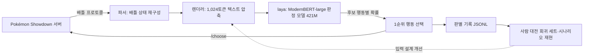

# laya: 포켓몬 배틀 의사결정 모델 학습·평가

Pokémon Showdown Gen 9 OU 싱글 배틀에서 매 턴의 행동(기술·교체·테라스탈)을 고르는 모델을 학습하고,
학습과 분리된 평가 체계로 개선 여부를 판정하는 개인 연구 저장소다.

## 핵심 결과

| 항목 | 결과 |
| --- | --- |
| 사람 선택 재현 (잠긴 test 1,024결정) | 행동 일치율 46.78% (같은 자료로 학습한 Qwen3.5-4B 31.25%) |
| 규칙 봇 표준 32경기 | 25승 7패 (같은 일정의 공개 포켓몬 특화 LLM 6승 26패) |
| 학습에 없던 새 팀 32개, 128경기 | 89승 39패, 0.695 (95% CI [0.617, 0.773]) |
| 입력 표현 개선 v1 → v2, 256경기 | +0.102 (95% CI [0.023, 0.180]) |
| 실제 플레이어 대전 | 4승 16패. 실패 결정 24개와 대조 결정 3개를 회귀 세트로 고정 |

## 구조

## 연구 흐름

1. LangChain/LangGraph 도구 사용 Agent (초기 저장소 `pokechamp_langchain`)
2. API LLM(GLM 계열)의 프롬프트·하네스 개선: 튜닝 불가, 턴당 응답 지연
3. 포켓몬 특화 공개 모델 탐색·파인튜닝: Qwen3.5-4B 리플레이 모방 SFT, JevK5 규칙 QA LoRA(vLLM)
4. laya 모방 학습: 사람 리플레이 130,411결정, 1,024토큰 압축 입력

## 먼저 볼 문서

- [배틀 정책 학습 연구 색인](project_context/research/policy-learning/INDEX.md)
- [EX-118 laya 모방 학습](project_context/research/policy-learning/experiments/EX-118-laya-compact-imitation-training.md) · [EX-119 표준 32경기](project_context/research/policy-learning/experiments/EX-119-laya-compact-imitation-battle32.md) · [EX-120 새 팀 128경기](project_context/research/policy-learning/experiments/EX-120-laya-team-generalization128.md) · [EX-122 렌더러 v1·v2 비교](project_context/research/policy-learning/experiments/EX-122-laya-v1-v2-battle256.md)
- [사람 대전 실패 분석과 렌더러 v5 결정(D-195)](project_context/research/policy-learning/decisions/D-195-laya-item-state-renderer-v5.md) · [사람 대전 시나리오 목록](data/laya-scenarios.md)
- [laya 학습·서빙 코드](integration/laya_imitation/README.md) · [시나리오 재현 서버](integration/laya_scenario/README.md)
- [전체 실험 목록](project_context/catalog/experiments.md)

## 출처

- [PokéChamp](https://github.com/sethkarten/pokechamp)(ICML 2025)의 배틀 환경과 규칙 봇을 기반으로 한다.
- 판정 모델과 학습 라이브러리는 [laya](https://github.com/NandhaKishorM/laya)를 사용한다.
- `AgenticSTS/`는 AlayaLab의 공개 연구 코드(Apache-2.0, arXiv:2607.02255)로, 메모리 구조 참고용으로 포함했다. 이 저장소 작성자는 해당 논문의 저자가 아니다.

---

## 연구선 운영 안내 (작업자용)

현재 브랜치 `research/model-training`은 **모델 학습·정책 개선·독립 평가**를 위한 주 개발
연구선이다. 작업과 기존 실행 환경은 `/workspace`를 계속 사용한다.
[D-131](project_context/shared/governance/decisions/D-131-research-branch-preservation.md)에 따라 L1–L5 이식 연구는
별도 `research/l1-l5-port`에서 보존·후속 설계한다. 양쪽은 같은 공통 코드 기준선에서 출발한다.

브랜치·기준 태그·worktree·대형 자산 복사/검증과 목적 문서 분리의 범위·완료 근거는
[EP-135](project_context/shared/governance/plans/EP-135-research-branch-preservation.md)에서 관리한다.
새 연구 실험은 실행 중이지 않다.
기존 source·환경·모델·실험 evidence와 Blocked/Paused 판정을 보존한다.

- [모델 학습 연구 시작 매뉴얼](project_context/RESEARCH_MANUAL.md)
- [프로젝트 맥락과 작업 규칙](project_context/INDEX.md)
- [이 연구선의 목표](project_context/CHARTER.md) · [연구 설계](project_context/RESEARCH_DESIGN.md)
- [현재 작업·제한](project_context/STATUS.md) · [구성](project_context/ARCHITECTURE.md)
- [작업·새 출력·외부 자산·복원 안내](project_context/RESEARCH_WORKFLOW.md)

외부 보존 루트는 `<BACKUP_ROOT>/pokechamp-research`다(`<BACKUP_ROOT>`는 연구 서버의 백업 스토리지 경로이며, 실제 값은 각 실행기의 기본 출력 경로에 있다). 새 실험 출력은 승인된 새 ID와 기존 CLI의 명시적 출력 인자를
사용하여 그 아래 `runs/model-training/<새 실험 ID>`에 둔다. 출력 선택이 없는 과거 실행기는
자동 재사용하지 않으며 기존 manifest·봉인·고정 경로를 수정하지 않는다.

### AgenticSTS 연구 참고

AgenticSTS 관련 연구와 구현에 대한 자세한 내용은 [AgenticSTS 연구 폴더](AgenticSTS)를 참고하세요.
