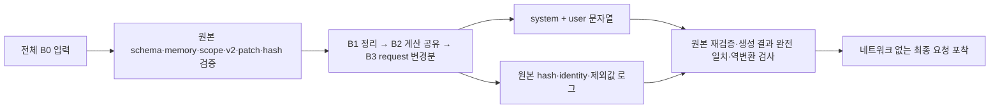

# B 프롬프트 판단 정보 보존형 최적화

## 새 공식 관측 B2 경계

새 B2 준비는 `b2-official-v1`으로 공식 관측·동일 입력 기반 계산·상세 효과 사전·정확한 전송 문자열을 연결한다. [공식 관측 안내](../integration/pokechamp/observation/README.md)와 [검증 보고](../project_context/exec-plans/evidence/ep056/report.md)를 따른다.

## 보존된 B2 설명·사전 경계

동결 B0–B3 codec은 그대로 유지한다. 명시적 legacy 신규 선봉 준비의 b2-effects-v1은 B2 projection에 효과 사전을 추가하고 별도 구조 설명서와 전송 검증을 사용한다. 과거 EX의 B2 문자열은 변경하지 않는다.

[상세 계약·생성법](../integration/pokechamp/effects/README.md) · [검증 보고](../project_context/exec-plans/evidence/ep046/report.md)


[D-046](../project_context/decisions/D-046-b-prompt-optimization.md)과
[C-030](../project_context/CONTRACTS.md#c-030--b-오프라인-전달-표현)의 별도 오프라인 인터페이스다.
EX-037의 B0 원문, 운영 `battle-v1.2.0`, 관측·prior·계산식·출력복구는 보존한다.
B1/B2/B3는 현재 live selector에 등록하지 않는다.

## 사용과 검증 경계

기존 pinned Python 환경과 계산기 패치가 설치된 저장소에서 실행한다. 일부 기존 데이터
로더는 PokéChamp working directory를 요구한다.

```bash
cd /workspace/pokechamp
PYTHONPATH=/workspace .venv/bin/python -m integration.pokechamp.improved_io.delivery generate \
  --input /path/to/full-input.json --candidate B3 --battle-format gen9ou \
  --output /path/to/new-output-directory
```

새 디렉터리에 `system.txt`, `user.json`, `source-link.json`, `captured-request.json`을 쓴다.
기존 디렉터리 덮어쓰기는 거부한다. 모델 호출은 없다. 현재 예시 전체 입력은
[전수 비교 보고서](../project_context/exec-plans/evidence/ep034/audit-v2/report.md)에 연결한다.

전체 EX-037 재검증 명령은 다음과 같다. `--bundles`에는 실패 경기까지 포함한64개 actor
bundle이 있어야 하며 B32 actor·1060입력·1057응답·3미수신 분모를 검사한다.

```bash
cd /workspace/pokechamp
PYTHONPATH=/workspace .venv/bin/python -m integration.pokechamp.improved_io.delivery audit-ex037 \
  --bundles /workspace/.pokechamp-data/experiments/ex037-cloud/battles \
  --output /path/to/new-audit-directory
```

Python API는 `generate(full, candidate, battle_format="gen9ou", origin=...)` 또는
`generate_all(...)`이다. 결과 `Delivery`는 후보 버전, 계산 의미 버전, system/user 문자열,
원본 연결 JSON을 가진 frozen dataclass다. `capture_request`는 원본을 다시 검증하고 후보
생성 결과와 전달 문자열·버전·연결의 완전 일치를 요구한 뒤 최종 messages를 UTF-8로
직렬화/포착한다. 실제 provider 연결은 후속 범위다. API의 `origin`은 caller가 제공하는
출처 표식이며 파일 권한이나 독립 신뢰를 부여하지 않는다. CLI는 입력 파일의 hash를,
전수 감사는 봉인된 원본 bundle의 hash·actor·decision·event를 직접 확인해 연결한다.
항상 내용 자체의 `original_user_sha256`이 함께 기록된다.



`B0`–`B3`와 `b-delivery-v1`은 전달 표현 버전이다. `calculator-input-v2`는 별도의 필수
계산 의미 버전이다. 신규 후보 이름으로 원래 state·request·bundle hash 및 패치 검사를
건너뛰지 않는다. B0도 동일한 검증을 수행한 뒤 과거와 동일한 문자열을 제공한다.

## 단계별 필드 매핑

[전체 필드 매핑](../project_context/exec-plans/evidence/ep034/audit-v2/field-mapping.json)은
기존 catalog의 경로·자료형·열거형과 단계별 표현을 연결한다. 전체 명세는
[원래 fields.json](../integration/pokechamp/improved_io/prompts/battle-v1.2.0/fields.json)에 유지한다.
아래는 주요 변경이다. 미분류 경로는 원본 검증에서 거부하고 임의의 suffix로 필드를 삭제하지 않는다.

| 원본 필드/자산 | B1 | B2 | B3 |
|---|---|---|---|
| actor·battle·turn·decision·request 식별, legal_actions 순서 | 유지 | 유지 | 유지 |
| 현재 관측·원래 자기 세트·상대 공개 사실·고정 prior·unknowns | 유지 | 유지 | 유지 |
| condition_id, 빈 lesson_memory/battle_summary | B/[]/null 전제 검사 후 로그에 보존 | 동일 | 동일 |
| identity.state_id와 계산 identity의 동일 hash | 원본 검증·로그에 보존 | 동일 | 동일 |
| 계산 elapsed_ms, engine_patch, runtime_patch, request/bundle SHA-256 | 원본 검증·로그에 보존 | 동일 | 동일 |
| self_team 및 RequestJSON.side.pokemon의 pokeball | 외형만 로그에 보존 | 동일 | 동일 |
| RequestJSON의 ally 및 active의 legacy mechanic 옵션 | 미사용 값만 제외; 활성 값 거부 | 동일 | 동일 |
| 전술 절차·최종 행동 JSON 계약 | 원문 유지 | 유지 | 유지 |
| 전체 경로를 반복 설명하는 설명서 | 제외 필드 설명 정리 | 공통 정의·시점·단위·불확실성 규칙 | 변경분 읽기 규칙 추가 |
| entries/coverage의 scenario_id | 유지 | scenarios 한 행으로 join | 동일 |
| coverage.action/direction/move/target/target_mode/execution | 유지 | 같은 행에 직접 보존 | 동일 |
| entry의 결과 필드 | 유지 | 같은 행의 result에 보존 | 동일 |
| 시나리오 가설·HP·대상 | ID 및 원문 구조 | hN-hpX를 명시적 opponent_condition으로, 대상을 calculation_target으로 추가 | 동일 |
| 반복되는80자 이상 계산 문장 | 유지 | shared_text에 정확한 원문을1회 저장, 한 단계 참조 | 동일 |
| top-level 피해 배열과 variant 배열의 동일 사본 | 유지 | top-level에서 same_as_variant 참조; variant 배열은 그대로 유지 | 동일 |
| 서로 다른 시나리오/타수/위력/난수 배열 | 유지 | 합치지 않음 | 동일 |
| recent_events의 packet/event_seq/시점 | 유지 | 유지 | 동일 범위·순서 |
| protocol의 request JSON | 외형 등 명시 제외 외 유지 | 동일 | 최초 request_base + 이후 request_delta |
| request 안의 반복 파티 정보 | 유지 | 유지 | 동일 배열이면 상속, 변경 배열은 전체 교체 |
| 해석하지 못한 protocol 행 | 원문 보존 | 원문 보존 | 줄 끝까지 원문 보존 |

B1의 실제 제외값은 모두 경로·원래 값·사유와 함께 별도 로그에 남는다.
`restore_projection`은 B2/B3의 표현을 B1 구조로 복원한다. 독립적인
`preservation.restore_source`는 허용 목록에 있는 로그 값만 다시 넣어 전체 원본과 대조한다.
따라서 전방 변환기와 동일한 삭제 연산만 재사용하는 검사가 아니다.

B2부터 outer user JSON은 의미 없는 구분 공백도 제거한다. 이 직렬화 절감은 B2의 실측에 포함한다.
B2 공통 조건은 문자열만 참조하므로 참조 사슬을 만들지 않는다. `same_as_variant`는 해당
행의 같은 필드 이름에 있는 literal 값을 한 번 참조한다. 계산 행 간 피해 배열을 합치지
않으며 다중타격의 중첩·중복 roll·순서와 위력 분기를 보존한다. `null` 확률은 미측정이며
제외 결과는0피해/생존 확정이 아니다. HP 단위와 반올림, 과거/현재 시점, 효과의 존재와
지속시간, Future Sight 미래 상태 미상 등의 규칙을 짧은 설명서에도 명시했다.

B3 변경분은 객체에 `delete`, `set`, `patch`를 적용하고 값/배열은 `replace`로 교체한다.
키 삭제와 `null`·빈 배열·빈 객체를 구분하며 첫 request는 해당 입력 안에 완전한 상태로
존재한다. 이전 모델 호출이나 최근10결정 밖의 request에 의존하지 않는다. 원본 JSON의
공백과 객체 key 순서는 표현으로 취급하지만 배열의 순서·자료형·값과 미해석 행은 보존한다.

## 해석 범위

오프라인 통과는 원본과 연결된 정보 보존 및 입력량 실측이다. 압축된 정보를 모델이 동일하게
해석한다는 증거는 아니다. 승률·판단력·실제 provider 지연은 평가하지 않았으며, 과거 선택
행동과의 일치를 정답 기준으로 사용하지 않았다. 일치하는 tokenizer를 검증하지 않아 토큰
절감률은 미측정으로 둔다. 단계별 실제 예시·크기·한계·회귀 결과는
[검토 보고서](../project_context/exec-plans/evidence/ep034/report.md)를 따른다.
