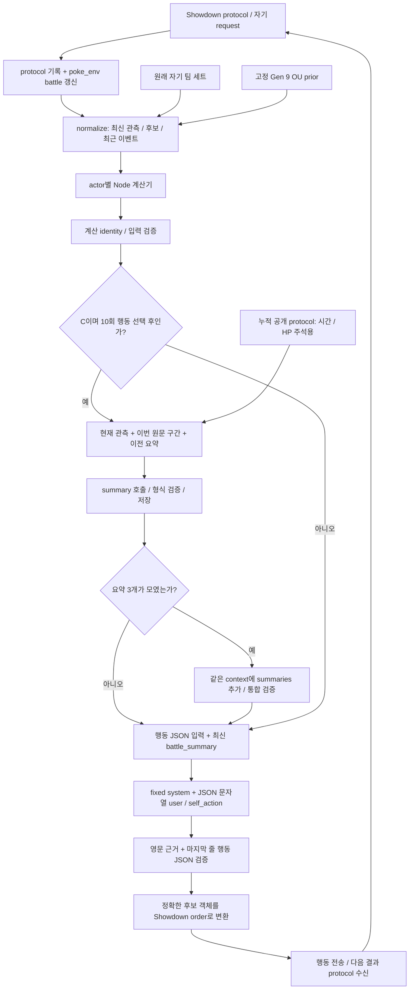

# PokéChamp의 현재 행동 입력·요약 구조

EX-112의 `jev-choice-v6 + candidate-matchup-v1` 전체 필드와 API 포장 형식은
[별도 입력 구조 참조](../project_context/research/input-and-memory/EX112_INPUT_STRUCTURE.md)에 정리했다.
아래 B/B2·JEV 설명은 각 절의 적용 버전을 기준으로 읽는다.

현재 새 B/B2는 [공식 관측 경로](../integration/pokechamp/observation/README.md)를 사용한다.
모델과 계산은 같은 행 경계의 정규화 관측을 공유하며 v1.4.0/B2 b2-official-v1을 봉인한다.
이 문서의 기존 parser·요약·과거 실행 설명은 해당 legacy/C 버전의 경계로 읽는다.
[현재 구조](../project_context/ARCHITECTURE.md)·[검증과 viewer](../project_context/exec-plans/evidence/ep056/report.md).

## JEV 새 기본 입력

별도 JEV 경로는 `jev-choice-v3`의 공식 관측·합법 Choice 후보와 사용자 제공 Gen9 기본 지식
원문을 사용한다. `state.effect_reference`에 요청의 자기·확인된 상대·후보·최근 공개 이력에
등장한 항목의 고정 영어 name/desc를 ID별 한 번 제공한다. 사전은 상대 보유·발동의 증거가 아니다.
모델 payload에는 `current_pp_source`가 없으며 PP 값·이유·검증은 유지한다. 원래 관측/request,
초기 PP 정책과 사전 identity는 모델 밖 감사 기록이다. v1/v2는 당시 버전으로 재현한다.
[계약](../project_context/research/model-evaluation/CONTRACTS.md#c-045-jev-battle) · [전후 예시·검증](../project_context/exec-plans/evidence/ep074/report.md)

## 현재 새 준비의 효과 사전

D-061의 새 선봉은 [C-040](../project_context/research/lead-policy/CONTRACTS.md#c-040-lead-components)에 따라 독립 전략·Dex 규칙을 적용한다. 완성된 기존 입력의 공개 cutoff 뒤에서만 규칙을 보강하며 실제 자기 기술과 종의 가능 목록을 분리한다. [구현/예시](../project_context/exec-plans/evidence/ep050/report.md).

D-057의 B/B2·선봉 요청은 원본을 보존한 모델용 JSON에 effect_reference를 추가한다. 상태/합법 행동/가설/계산 수치와 선봉 공개 cutoff는 유지한다. 아래의 기존 입력·요약 lifecycle 설명에 대한 추가 경계다.

[상세 계약·생성법](../integration/pokechamp/effects/README.md) · [검증 보고](../project_context/exec-plans/evidence/ep046/report.md)


기준일: 2026-09-10. 이 문서는 현재 worktree의 parent integration을 설명한다. 연구자는
아래 흐름·메모리 타임라인을, 개발자는 필드 표·JSON 발췌·코드 및 봉인 자료 링크를 따라갈 수 있다.
세 prompt의 전체 영어 원문과 파일 해시는 [prompt 원문 부록](pokechamp-prompt-originals.md)에 있다.

여기에 설명하는 B/C 경로는 구현되어 있지만 Cloud 배틀 자격과 48판 비교를 완료하지 못했다.
[EP-011](../project_context/research/input-and-memory/plans/EP-011-improved-io.md)은 요약 gate 실패로,
[EP-015 / EX-025](../project_context/research/input-and-memory/experiments/EX-025-summary-max-diagnostic.md)는 입력·평가 불일치로
`Blocked`다. EX-025의 132응답은 전체 무효이고 유효 비교는 0이다. 아래 EX-025 자료는
**입력 구조와 검증 한계를 설명하는 사례**이며 low/max 효과나 L1-L5 전체의 효능 근거가 아니다.
현재 상태의 authority는 [STATUS](../project_context/STATUS.md), 입력·출력 경계는
[CONTRACTS C-014/C-016/C-017](../project_context/CONTRACTS.md)다.

새 요약 없는 B 행동 v1.2.0은 `calculator-input-v2`를 사용한다. 전체 공개 prefix에서 소비·억제
이력을 보존하고, 계산 bundle은 현재·선택 교대·선택 테라를 분리한다. 입력/worker/bundle 해시,
추가 테라 방어 coverage, 피해 branch와 필수 필드 검증이 실제 LLM 호출에 앞선다.
[EX-030 조사 보고서](../project_context/exec-plans/evidence/ep023/report.md)와
[필드 설명서](pokechamp-battle-field-guide.md)가 새 의미를 정의한다. 아래 과거 B/C 요약
사례와 영어 prompt 원문은 당시 버전의 사례이며 새 입력으로 소급 변환하지 않는다.

## 1. 전체 흐름과 A/B/C의 차이

아래는 B/C의 한 행동 요청이다. 수신 protocol을 기록하고 pinned `poke_env`가 battle을 갱신한 뒤
`FixedPlayer._fixed_decision`이 실행된다. request와 현재 관측을 정규화하고, 같은 identity의 계산을
완료·검증한 후에만 LLM을 호출한다. C의 요약이 예정되어 있으면 행동 호출보다 먼저 수행한다.



검증 실패는 실패 범주와 trace를 남기고 해당 경기의 후속 호출을 중단한다. B/C에는 응답 수리나
대체 행동 fallback이 없다. 경로 근거: [player.py](../integration/pokechamp/improved_io/player.py),
[관측 trace wrapper](../integration/pokechamp/observability/player.py),
[backend.py](../integration/pokechamp/improved_io/backend.py),
[후보·order 변환](../integration/pokechamp/benchmark_player.py).

| 조건 | 행동 경로 | 배틀 내 요약 | 정보·실패 경계 |
|---|---|---|---|
| A | `method=io`, `action_policy=upstream`; EX-016 upstream 행동 경로 | 없음 | 기존 upstream prompt·행동 생성/fallback 의미. 아래 fixed JSON 필드 표를 A의 입력 형식으로 적용하지 않는다. |
| B | `method=io`, `action_policy=fixed`; 교정 관측 + 고정 prior + 계산 + fixed prompt | 비활성 | 최근 10결정 구간 원문, `battle_summary=null`, `lesson_memory=[]`; 첫 입력·계산·출력 오류로 경기 중단 |
| C | B의 동일 행동 경로 | 10회 행동 선택마다 요약, 요약 3개마다 통합 | 최근 10결정 구간과 최신 요약을 함께 제공; 요약 오류도 중단 |

조건 정의는 [conditions.py](../integration/pokechamp/improved_io/conditions.py)와
[D-019](../project_context/research/input-and-memory/decisions/D-019-improved-io.md)에 있다. 같은 정책을 쓴다는 뜻과 실험 gate를
통과했다는 뜻은 다르다. 배틀 간 학습이나 완성된 L1-L5 전체 메모리 계층은 이 경로에 없다.

## 2. 행동 입력은 어디서 오는가

`normalize`가 기본 객체와 내부 후보 객체를 만들고, player가 `condition_id`, 계산 결과,
필요하면 최신 요약을 붙인다. 표의 최상위 필드 전체가 `json.dumps(..., ensure_ascii=False)`로
직렬화되어 행동 LLM의 user 메시지가 된다. 내부 후보 객체는 별도로 보관하여 응답을 실제
move/Pokémon 객체에 연결한다.

| 필드 | 생산·출처 | 내용과 소비 지점 |
|---|---|---|
| `condition_id` | player의 실행 조건 | B/C 식별; backend trace와 역할별 입력에 사용 |
| `identity` | battle/actor 지정값, recorder, 최신 request·battle, 정규화 내용 해시 | `battle_id`, `actor_id`, `decision_seq`, `request_id`(rqid), `showdown_turn`, `state_id`; 계산·요약·trace의 귀속 검사 |
| `request` | 최신 자기 request + parser의 현재 available 후보 | `kind`, `force_switch_cause`, `pending_opponent_action`, `can_tera`, `legal_actions`; 행동 parser가 정확한 후보 포함 여부 검사. **원문 request 전체와 다른 정규화 객체**다. |
| `current_observation` | 자기 request·원래 자기 세트·parser + 수신 공개 protocol 보완 | 현재 자기 팀/상대 공개 정보, field·효과·진영 상태; 계산기와 행동 LLM, 요약 builder 모두 사용 |
| `opponent_hypotheses` | 활성 상대의 공개 정보 + 봉인 `prior.json` | 조건부 spread/item/ability/moves 조합. 계산 scenario와 행동 추론에 사용; 상대 정답 세트가 아님 |
| `recent_events` | `io_protocol[cutoff:]` | 운영 B/C 공통의 최근 10개 행동 선택 구간 protocol; 행동 LLM의 근거 |
| `calculation_bundle` | `compute` → actor 소유 Node 계산기 | engine/patch·identity·coverage·entries·uncertainty·elapsed_ms 등. `validate_input` 확인 후 행동 LLM에 제공 |
| `battle_summary` | C의 최신 미통합 요약, 없으면 `consolidated` | `{battle_id, actor_id, text}` 또는 `null`; 행동에 retained history 제공. 최신 관측 필드를 덮어쓰지 않음 |
| `lesson_memory` | 매번 빈 배열로 초기화 | 항상 `[]`; 입력 검증기도 비어 있지 않으면 거부. 배틀 간 lesson 주입 없음 |
| `unknowns` | builder의 명시적 불확실성 문구 | 상대 HP 반올림·prior 비포괄성·KO/생존 확률 미제공을 행동 LLM에 전달 |

구현 근거: [state.py의 normalize/hypotheses/public_revelations](../integration/pokechamp/improved_io/state.py),
[calculations.py](../integration/pokechamp/improved_io/calculations.py),
[gate.py](../integration/pokechamp/improved_io/gate.py). `state_id`는 identity를 붙이기 전 정규화 core의
해시다. 계산 결과·`condition_id`·나중에 넣는 요약 본문을 포함한 최종 user 메시지 전체 해시가 아니다.
요약 context는 행동 정규화 때의 identity를 이어받으며 별도의 요약 본문 hash와 혼동하지 않는다.

### 자기 정보·공개 관측·추정의 경계

| 관측 내부 | 실제 출처와 의미 |
|---|---|
| `self_team` | `request.side.pokemon`의 `ident`, `details`, `condition`, `active`, `stats`, `moves`, `item`, `ability`, tera 등과 parser의 boosts/effects. 자기 HP는 `condition="301/301"` 같은 정확한 값이다. |
| `self_team[].original_set` | 처음 전달한 자기 팀 문자열을 파싱한 nature/EV/IV/level/tera type. 원래 기술 집합과 request의 owned moves가 일치해야 한다. 자기 세트가 모호하거나 지원하지 않는 변형이면 거부한다. |
| `opponent_confirmed` | parser가 보유한 상대 공개 관측에 protocol의 공개 기술·아이템·특성 발동을 보완한다. 필드 이름이 모든 값의 확정을 뜻하지 않으며 `unknown_item`, `ability=null`, `ability_known=false`가 가능하다. |
| `protocol_state`, `effects`, `parser_effects` | 공개 protocol에서 추적한 현재 상태와 parser 원본 marker/counter를 분리한다. 종료 효과·지연 기술의 대상 위치/발생 시점을 구별하며 원문 근거가 없으면 미상이다. |
| `weather`, `field`, 양측 `side_conditions` | parser의 숫자는 일괄적인 남은 턴 수가 아니다. 날씨는 마지막 weather protocol 턴, Spikes/Toxic Spikes는 겹 수, 다른 해당 field/side 값은 설치·활성 턴이다. 요약의 `numeric_state` 주석이 의미를 명시한다. |
| `order_assessment` | 현재 builder는 `relation="unknown"`과 우선도·속도·동률·미공개 세트 조건을 넣는다. 계산 entry의 조건부 속도 비교도 실제 행동 순서의 보장이 아니다. |

`self_team[].moves`는 보유 기술이고 `request.legal_actions`는 **이번 요청에서 선택 가능한 행동**이다.
PP·disabled 등 원문 `request.active` 정보는 원문 이벤트로도 들어오며, 상단의 정규화 `request`에는
그 전체가 직접 복사되지 않는다. 상대의 공개 HP `hp=51, max_hp=100`은 실제 최대 HP 100을
뜻하지 않는다. `hp_precision="rounded_server_fraction"`인 서버 표시 비율이다. 계산기는
각 가정 세트의 최대 HP와 pinned 서버의 반올림 규칙(부상 시 99 표시 예외 포함)을 적용해
가능한 정수 HP의 양끝을 계산한다.

고정 prior는 [prior.json](../integration/pokechamp/improved_io/prior.json)의 주변 분포에서
상위 spread 2개, 미공개 item이면 상위 item 2개, 알려지지 않은 ability 후보를 조합한다.
공개 item/ability가 있으면 그것을 우선하며, 소모·제거된 item을 prior로 되살리지 않는다.
확인 기술에 prior 기술을 최대 4개까지 보충하고 `confirmed_moves`를 별도로 남긴다.
`joint_probability=null`이며 모든 가능한 세트를 포괄하거나 joint 확률을 계산한 것이 아니다.
운영 `normalize`의 인자에는 상대 실제 팀/manifest가 없다. 사후 정답 계산은 별도
[posthoc.py](../integration/pokechamp/improved_io/posthoc.py) 경로다.

계산은 합법 공격/tera 변형의 outgoing과 자기 활성·교체 후보가 받을 수 있는 incoming scenario를
만든다. `coverage[].scenario_id`가 `entries[]`와 연결된다. 엔진은 `@smogon/calc 0.11.0`에
`ruination-v1` 패치를 적용하며 patch 및 적용 파일 해시를 검증한다. 상대 가정·명중·실행 조건이
붙은 수치다. `ko_chance_given_hit`/`survival_given_hit`의 `null`은 0이나 확정 생존이 아니다.
Future Sight는 현재 가정 target/field에 대한 지연 피해로 표시하며 미래 상태를 예측한 값이 아니다.

### 실제 발췌: IO-C01 일반 행동

이 절의 두 사례는 **EX-025 사전검증 offline-final-v2의 봉인된 재생 입력**이다. 값·키와 배열
원소는 실제 입력에서 골랐으며 설명용 새 값을 넣지 않았다. 생략된 필드를 복원하지 않은 JSON은
실제 전송 가능한 전체 요청이 아니다. 전체 파일 및 옆의 `.sha256`, 같은 디렉터리의
[source archive](../.pokechamp-data/summary-diagnostics/ex025-preparation/offline-final-v2/source)로
당시 입력과 코드를 추적할 수 있다.

[IO-C01 전체](../.pokechamp-data/summary-diagnostics/ex025-preparation/offline-final-v2/IO-C01.json):
자기 p1 Latios가 정확히 301/301이고 상대 p2 Hydrapple은 공개 100/100이다. 아래는 합법 행동
13개 중 2개, 자기/상대 각각 활성 1개, prior 첫 조합, 계산 384개 중 첫 entry와 대응 coverage를
남겼다. 다른 관측 필드, 계산 identity/patch/시간/불확실성, 최근 원문 8개 등은 생략했다.

<!-- example: IO-C01 -->
```json
{
  "identity": {
    "actor_id": "p1",
    "battle_id": "io-abyssal-b01-s0-a1-p1",
    "decision_seq": 2,
    "request_id": 4,
    "showdown_turn": 1,
    "state_id": "f200d14de94b6ecda4788afb3796578d4a703274908a002475fc5b83acf38065"
  },
  "battle_summary": null,
  "lesson_memory": [],
  "request": {
    "kind": "turn_action",
    "force_switch_cause": "not_forced",
    "pending_opponent_action": "UNKNOWN",
    "can_tera": true,
    "legal_actions": [
      {
        "move": "dracometeor"
      },
      {
        "switch": "zamazenta"
      }
    ]
  },
  "current_observation": {
    "self_team": [
      {
        "ident": "p1: Latios",
        "species": "latios",
        "condition": "301/301",
        "hp_precision": "exact_self_request",
        "item": "souldew",
        "moves": [
          "dracometeor",
          "psychicnoise",
          "flipturn",
          "recover"
        ],
        "original_set": {
          "evs": {
            "atk": 0,
            "def": 4,
            "hp": 0,
            "spa": 252,
            "spd": 0,
            "spe": 252
          },
          "ivs": {
            "atk": 31,
            "def": 31,
            "hp": 31,
            "spa": 31,
            "spd": 31,
            "spe": 31
          },
          "level": 100,
          "nature": "Timid",
          "tera_type": "Steel"
        }
      }
    ],
    "opponent_confirmed": [
      {
        "ident": "p2: Hydrapple",
        "species": "hydrapple",
        "hp": 100,
        "max_hp": 100,
        "hp_precision": "rounded_server_fraction",
        "item": "unknown_item",
        "ability": null,
        "ability_known": false,
        "moves": []
      }
    ]
  },
  "opponent_hypotheses": [
    {
      "source": "fixed_gen9_ou_prior",
      "item": "Heavy-Duty Boots",
      "ability": "Regenerator",
      "moves": [
        "nastyplot",
        "gigadrain",
        "earthpower",
        "ficklebeam"
      ],
      "confirmed_moves": [],
      "joint_probability": null
    }
  ],
  "calculation_bundle": {
    "engine": "@smogon/calc",
    "engine_version": "0.11.0",
    "generation": 9,
    "status": "success",
    "coverage": [
      {
        "action": {
          "move": "dracometeor"
        },
        "direction": "outgoing",
        "execution": "conditional on hit; execution is not predicted",
        "scenario_id": "out-move-dracometeor-h0-hp414"
      }
    ],
    "entries": [
      {
        "scenario_id": "out-move-dracometeor-h0-hp414",
        "damage_range_hp": [
          614,
          726
        ],
        "defender_max_hp": 414,
        "ko_chance_given_hit": null,
        "survival_given_hit": null
      }
    ]
  }
}
```

이 수치는 가정 h0의 최대 HP 414인 상대에 대한 Draco Meteor 계산이며 실제 선택·명중·행동 실행의
관측 결과가 아니다. `Heavy-Duty Boots`/`Regenerator`와 prior 기술은 이 장면에서 공개된 사실이
아니다. 원문 관측의 `item="unknown_item"`, `ability_known=false`, `moves=[]`와 구분한다.

### 실제 발췌: IO-C05 강제 교체

[IO-C05 전체](../.pokechamp-data/summary-diagnostics/ex025-preparation/offline-final-v2/IO-C05.json):
자기 p2 Tinkaton이 기절했고 합법 행동은 3개의 switch뿐이다. identity/request 전체와 활성 관측의
일부, 계산 96개 중 첫 incoming entry/coverage를 발췌했다. 나머지 팀·관측·prior·메모리 필드와
57개 원문 이벤트 및 계산 세부는 생략했다.

<!-- example: IO-C05 -->
```json
{
  "identity": {
    "actor_id": "p2",
    "battle_id": "io-abyssal-b01-s1-a1-p2",
    "decision_seq": 23,
    "request_id": 55,
    "showdown_turn": 19,
    "state_id": "381a84d374bc966f3b74af9940c726d6bf7e46b05e18c736ac80a90576c9413e"
  },
  "request": {
    "can_tera": false,
    "force_switch_cause": "faint",
    "kind": "forced_switch",
    "legal_actions": [
      {
        "switch": "slowkinggalar"
      },
      {
        "switch": "tinglu"
      },
      {
        "switch": "hydrapple"
      }
    ],
    "pending_opponent_action": "UNKNOWN"
  },
  "current_observation": {
    "self_team": [
      {
        "ident": "p2: Tinkaton",
        "condition": "0 fnt",
        "hp_precision": "exact_self_request"
      }
    ],
    "opponent_confirmed": [
      {
        "ident": "p1: Lokix",
        "hp": 100,
        "max_hp": 100,
        "moves": [
          "firstimpression"
        ]
      }
    ]
  },
  "calculation_bundle": {
    "coverage": [
      {
        "direction": "incoming",
        "execution": "conditional on hit; execution is not predicted",
        "move": "firstimpression",
        "scenario_id": "in-slowkinggalar-firstimpression-h0-hp283",
        "target": "slowkinggalar"
      }
    ],
    "entries": [
      {
        "scenario_id": "in-slowkinggalar-firstimpression-h0-hp283",
        "damage_range_hp": [
          244,
          288
        ],
        "defender_max_hp": 393
      }
    ]
  }
}
```

`decision_seq=23`과 `showdown_turn=19`는 같은 시계가 아니다. 강제 교체는 기절뿐 아니라
pivot·item 발동 중에도 발생할 수 있다. `force_switch_cause`는 `faint`, `pivot`, `item`, `UNKNOWN`
등으로 구별하지만 `pending_opponent_action`은 현재 builder에서 항상 `UNKNOWN`이다.
첫 incoming 수치만으로 교체 직후 First Impression이 실제로 다시 실행된다고 단정할 수 없다.
`wait`, `teamPreview`, 종료 battle은 이 fixed 행동 builder의 대상이 아니다.

**오프라인 자료와 운영 window의 차이:**
[offline.py](../integration/pokechamp/improved_io/offline.py)는 선택 결정 이전의 전체 protocol prefix를
`normalize`에 넣었다. 이 IO-C05의 `recent_events`는 event 2–145 중 protocol 57개이며 운영의
최근 10구간으로 잘린 예시가 아니다. IO-C01은 event 2–12 중 8개다. 두 파일에는 아직 실행별
`condition_id`가 없고 `battle_summary=null`이다. 이를 C의 완성된 실제 Cloud 요청으로 표시하지 않는다.

## 3. 첫 요약·후속 요약·통합의 lifecycle

### 두 종류의 구간과 호출 시점

운영 [player.py](../integration/pokechamp/improved_io/player.py)는 행동을 고르고 order로 변환한 뒤
현재 protocol 리스트 길이를 `io_boundaries`에 추가하고 `memory.decisions`를 1 증가시킨다.
10번 이상 선택했다면 다음 행동 입력의 `recent_events` 시작은 `io_boundaries[-10]`이다.
그 전에는 시작값 0을 쓴다. 이는 10개 protocol 행이나 10개 배틀 턴이 아니라 **최근 10개 결정
구간**이다. 기록되는 boundary는 protocol 리스트 offset이며 trace의 event ID와도 다르다.

C의 `due()`는 `decisions - summarized_decisions >= 10`이다. 10번째 행동 선택 직후에는 그 행동의
실행 결과가 아직 없으므로 요약하지 않는다. **다음 행동 요청에서 이전 결과를 반영한 관측·계산을
검증한 후, 다음 행동을 고르기 전에** 첫 요약을 호출한다. 결과 반영은 공격 성공을 뜻하지 않는다.
실패·취소·기절도 protocol의 결과이며, 이후 요청 없이 배틀이 끝나면 이 경로의 마지막 요약 flush는 없다.
recorder의 `decision_seq`에는 team preview 같은 결정도 포함될 수 있어 `memory.decisions`와
숫자가 같다고 가정하지 않는다. EX-025 첫 경계는 10회 행동 후 `decision_seq=12`다.

요약의 `source_events`는 `io_summary_boundary` 이후부터 현재까지의 원문이다. 첫 요약은 0부터,
다음 요약은 **직전 요약에 사용한 경계 이후**만 준다. `observed_protocol` 전체 prefix는
행 순서의 발생 턴·직전 HP를 이어받는 주석 계산에 사용하고, 모델로 전달하는
`event_annotations` 행은 이번 원문 구간으로 제한한다. 따라서 주석의 `hp_before`나
`hp_before_ref`가 경계 앞 사실을 이어받을 수 있지만 전체 과거 원문이 다시 제공되는 것은 아니다.

`recent_events`와 요약 window는 각각 계산한다. 행동 입력에는 최신 요약과 최근 10결정 구간이
동시에 들어가므로 둘 사이의 일부 정보 중복은 정상이다. 전체 `io_protocol`과 `archive`는
actor 메모리에 남지만 다음 LLM 메시지에 전체를 자동 append하지 않는다.

### 요약 입력과 행동 입력의 비교

[공통 summary_context/summary_window](../integration/pokechamp/improved_io/memory.py)가 아래 객체를
만든다. 운영 player와 오프라인 요약 경로가 이 builder를 공유한다.

| 내용 | 행동 user 객체 | summary / summary_rollup user 객체 |
|---|---|---|
| 조건·identity | `condition_id`, `identity` | 동일 이름. battle/actor/현재 결정 귀속 유지 |
| 최신 상태 | `current_observation` | 그대로 복사; 자기 원래 세트도 이 내부에 포함됨 |
| 정규화 행동 request·후보 | `request.legal_actions` 등 | 최상위 `request` 없음. 원문 `source_events`의 `\|request\|` JSON에는 당시 request/자기 기술 등이 남아 있을 수 있음 |
| 최근 원문 | `recent_events`: 최근 10결정 구간 | `source_events`: 첫 구간 또는 직전 요약 경계 이후 구간 |
| 행 의미 주석 | 최상위 `harness_annotations` 없음; `protocol_state`는 관측 내부 | `harness_annotations.numeric_state`, `.event_annotations`; 발생 턴·HP 정밀도·행위자/대상·관련 ref |
| 인용 ID 허용 목록 | 별도 최상위 목록 없음 | `source_event_ids`: 현재까지의 전체 protocol ID prefix. 이번 원문 구간보다 넓을 수 있음 |
| 직전 메모리 | `battle_summary={battle_id,actor_id,text}` | `previous_summary`: 직전 미통합 요약, 없으면 통합 요약, 첫 회는 `null` |
| 통합 대상 | 없음 | `summary_rollup`에만 `summaries`: 시간순 3개 문자열 |
| 형식 보조 | fixed system 지시 | `output_identity_format`: 정확한 두 identity 행과 `[event:123]` 표기 안내 |
| 상대 가정·계산·lesson·unknowns | 각각 최상위 필드 | `opponent_hypotheses`, `calculation_bundle`, `lesson_memory`, `unknowns`를 직접 복사하지 않음 |

따라서 “요약이 행동용 계산 결과·prior까지 본다”는 설명은 틀리다. 반대로 “요약에는 자기 세트나
request 정보가 전혀 없다”도 틀리다. 최신 관측 내부와 원문 request에 포함된 사실은 남는다.
`request.kind`/`forceSwitch`가 최상위 요약 필드로 항상 보장되는 것도 아니다. prompt의 phase 관련
요구는 전달된 관측·원문에서 판단해야 하며, 원문과 필드에 없는 사실을 추정해 채워서는 안 된다.

### 메모리 저장과 다음 입력

아래 S1–S4와 R1은 **운영 lifecycle 설명용 기호**다. 실제 생성 응답 인용이 아니다.
`archive`는 검증을 통과한 요약/통합의 `{role,text,event_ids}`를 append한다.

| 다음 요청에 도달했을 때 | 호출에 사용되는 메모리 | 호출 후 `summaries` / `consolidated` | `archive` 길이 | 그 요청의 행동에 들어가는 요약 |
|---|---|---|---|---|
| 첫 10회 선택 전 | 요약 호출 없음 | `[]` / `None` | 0 | `null` |
| 10회 선택 후 | 첫 summary: `previous_summary=null` → S1 | `[S1]` / `None` | 1 | S1 |
| 20회 선택 후 | 다음 원문 + `previous_summary=S1` → S2 | `[S1,S2]` / `None` | 2 | S2만 |
| 30회 선택 후, summary 수락 | 다음 원문 + `previous_summary=S2` → S3 | `[S1,S2,S3]` / `None` | 3 | 아직 행동 전 |
| 같은 요청의 rollup 수락 | 방금 summary에 쓴 context에 `summaries=[S1,S2,S3]` 추가 → R1 | `[]` / R1 | 4 | R1 |
| 40회 선택 후 | 새 원문 + `previous_summary=R1` → S4 | `[S4]` / R1 | 5 | S4만 |

rollup은 S3 직후 같은 최신 관측·원문 구간·주석·ID 목록을 사용한다. `previous_summary`도 S3
호출 전 값인 **S2 그대로**이며, S3으로 교체하지 않고 `summaries`에 S3을 추가한다. 통합 수락은
`consolidated=R1`, `summaries=[]`로 갱신한다. `archive`는 지우지 않는다. 이후에는 최근 미통합
요약이 있으면 그것만 행동과 다음 summary의 메모리로 선택한다. `consolidated`와 `archive`의
모든 항목을 함께 검색·주입하는 구조가 아니다. 보관된 archive는 종료 evidence에도 쓰이지만
이 builder의 LLM 입력 선택 경로에서는 소비하지 않는다.

### 동일 actor의 실제 입력: s15 → s16 → s17 → s21

다음 네 파일은 EX-025의 `io-one_step-b01-s1-a1-p2`(SELF=p2, OPPONENT=p1)에 대한 **독립 진단 입력**이다.
운영의 첫 요약·후속 두 번·통합에 대응하는 모양을 보여주지만, 이 순서로 생성 응답을 재사용한
실행 타임라인은 아니다. M78/M142/M204는 각 경계의 원문으로 별도 작성한 고정 메모리다.

| 입력 | 역할·경계 | 결정 / rqid / 배틀 턴 | 실제 원문 구간 (protocol 개수) | 허용 ID prefix 개수 | 메모리 의존성 |
|---|---|---|---|---|---|
| [s15](../.pokechamp-data/summary-diagnostics/ex025/inputs/s15.json) | 첫 summary, cutoff 78 | 12 / 31 / 10 | event 2–77 (33) | 33 | `previous_summary=null` |
| [s16](../.pokechamp-data/summary-diagnostics/ex025/inputs/s16.json) | 후속 summary, cutoff 142 | 22 / 55 / 19 | event 82–141 (24) | 57 | `previous_summary=M78` |
| [s17](../.pokechamp-data/summary-diagnostics/ex025/inputs/s17.json) | 후속 summary, cutoff 204 | 32 / 77 / 27 | event 146–203 (22) | 79 | `previous_summary=M142` |
| [s21](../.pokechamp-data/summary-diagnostics/ex025/inputs/s21.json) | rollup, cutoff 204 | 32 / 77 / 27 | event 146–203 (22) | 79 | `previous_summary=M142`, `summaries=[M78,M142,M204]` |

범위 안의 event 번호는 연속 번호 목록이 아니다. decision·LLM 등 다른 trace event를 제외한
`protocol_in`만 제공한다. cutoff 자체는 다음 `decision_start`의 event ID이므로 원문에서 제외된다.
완전한 이전 메모리는 [M78](../.pokechamp-data/summary-diagnostics/ex025/memories/io-one_step-b01-s1-a1-p2@78.json),
[M142](../.pokechamp-data/summary-diagnostics/ex025/memories/io-one_step-b01-s1-a1-p2@142.json),
[M204](../.pokechamp-data/summary-diagnostics/ex025/memories/io-one_step-b01-s1-a1-p2@204.json)의 `text`다.
각 파일은 `claims`, 원문행 evidence, `source_sha256`, `review`도 보존하며 그 감사 metadata는 모델에
그대로 넣지 않는다. 연쇄 구성은 [maximum.py의 materialize](../integration/pokechamp/summary_diagnostics/maximum.py)를 따른다.

s15의 `context` 발췌다. identity와 `previous_summary=null`, 주석 75개 중 최초 Latios 등장 행만
남겼다. 현재 관측 전체·원문 33개·허용 ID·형식 안내·나머지 주석은 생략했다.

<!-- example: s15 -->
```json
{
  "condition_id": "C",
  "identity": {
    "actor_id": "p2",
    "battle_id": "io-one_step-b01-s1-a1-p2",
    "decision_seq": 12,
    "request_id": 31,
    "showdown_turn": 10,
    "state_id": "72fb4799ef2c8a513d3efd54186da423d009c42dcfe2df815060bf676a23167b"
  },
  "previous_summary": null,
  "harness_annotations": {
    "event_annotations": [
      {
        "hp_after": {
          "current": 100,
          "maximum": 100,
          "precision": "rounded_public",
          "raw": "100/100"
        },
        "kind": "switch",
        "observed_details": "Latios, M",
        "ref": {
          "event": 10,
          "line": 5
        },
        "target": "p1: Latios",
        "turn": 0
      }
    ]
  }
}
```

s16은 M78을 이전 요약으로 받는다. 다음은 identity 일부와 주석 71개 중 첫 행이다. 원문 event 82
패킷 말미는 `|turn|11`이지만 Stone Edge의 실제 발생 턴은 10이다. `previous_summary`의 긴 문자열과
나머지 context는 이 JSON에서 생략했으며 위 M78 링크가 그 전체 값이다.

<!-- example: s16 -->
```json
{
  "identity": {
    "battle_id": "io-one_step-b01-s1-a1-p2",
    "actor_id": "p2",
    "decision_seq": 22,
    "request_id": 55,
    "showdown_turn": 19
  },
  "harness_annotations": {
    "event_annotations": [
      {
        "kind": "move",
        "observed_details": "Zamazenta",
        "observed_move": {
          "move": "Stone Edge",
          "ref": {
            "event": 82,
            "line": 4
          },
          "target": "p1: Gliscor",
          "turn": 10,
          "user": "p2: Zamazenta"
        },
        "ref": {
          "event": 82,
          "line": 4
        },
        "target": "p2: Zamazenta",
        "turn": 10
      }
    ]
  }
}
```

s17은 M142를 받는다. 아래는 identity 일부와 주석 59개 중 Tinkaton 피격 행의 일부 필드다.
원문 구간은 event 146부터지만 `hp_before_ref`는 앞선 request인 event 141을 가리킨다. 공통 builder가
prefix를 사용해 직전 HP를 이어받은 결과이며, 원문 전체를 다시 붙인 것은 아니다.

<!-- example: s17 -->
```json
{
  "identity": {
    "battle_id": "io-one_step-b01-s1-a1-p2",
    "actor_id": "p2",
    "decision_seq": 32,
    "request_id": 77,
    "showdown_turn": 27
  },
  "harness_annotations": {
    "event_annotations": [
      {
        "ref": {
          "event": 146,
          "line": 7
        },
        "turn": 19,
        "kind": "-damage",
        "target": "p2: Tinkaton",
        "hp_before": {
          "current": 373,
          "maximum": 373,
          "precision": "exact_self",
          "raw": "373/373"
        },
        "hp_before_ref": {
          "event": 141,
          "line": 2
        },
        "hp_after": {
          "current": 171,
          "maximum": 373,
          "precision": "exact_self",
          "raw": "171/373"
        },
        "observed_hp_decrease": 202
      }
    ]
  }
}
```

s21의 저장 wrapper에서 역할·해시만 발췌하면 다음과 같다. 이 wrapper의 `context`, 두 prompt
문자열, prompt identity는 생략했다. wrapper 전체가 user 메시지는 아니며 `user_prompt` 문자열이
실제 user content다. s21의 `context`는 s17의 context에 `summaries=[M78,M142,M204]`를 추가한 것과
정확히 같다. M204는 s17의 생성 응답이 아니다.

<!-- example: s21 -->
```json
{
  "scene": 21,
  "kind": "rollup",
  "role": "summary_rollup",
  "system_sha256": "04c56a9dda3e3ac050c75bf495cb8e8ed2e8c3dccc97c8113fac89e4c68cd69b",
  "user_sha256": "4f52efa57dfe3c7701bbbb45463f07c91ebe86bdf325c2acfddd24538d198679"
}
```

## 4. Prompt와 실제 HTTP 전송

### 두 메시지와 버전 선택

[FixedPlayer._call_fixed](../integration/pokechamp/improved_io/player.py)는 해당 역할의 system prompt와
JSON 문자열 user prompt를 넘긴다. [cloud.py](../integration/pokechamp/cloud.py)는 다음 두 메시지를
`client.chat`에 전달한다. 아래 Python은 구조 설명이며 실제 전체 요청 로그가 아니다.

```python
messages = [
    {"role": "system", "content": system_prompt},
    {"role": "user", "content": json.dumps(context, ensure_ascii=False)},
]
```

B/C의 모든 역할은 `json_format=False`여서 user 뒤에 JSON-only 지시나 upstream의 JSON 시작
문구를 추가하지 않는다. 과거 대화를 messages에 계속 붙이지도 않는다. 이전 요약은 JSON 객체의
명시적 문자열 필드다. 모델 content와 provider reasoning은 trace에서 분리되며, 런타임 parser는
content의 행동/요약 출력을 검사한다.

| 역할 | system 자산 | 선택 규칙 |
|---|---|---|
| `self_action` | `prompts/battle_fixed.txt` | common policy + fixed profile v1.0.0. 요약 버전을 바꿔도 이 행동 자산은 동일 |
| `summary` | 기본 `prompts/summary.txt`, 선택 시 `prompts/<version>/summary.txt` | 기본 v1.0.0; EX-025는 v1.1.2 명시 |
| `summary_rollup` | 같은 버전의 `summary_rollup.txt` | summary와 쌍으로 version/hash 고정 |

[버전 선택 코드](../integration/pokechamp/improved_io/prompt_versions.py)의
`evidence.io_summary_prompt_version` 부재는 v1.0.0이다. `io_summary_prompt_identity`를 선언했으면
선택한 버전의 두 해시와 일치해야 한다. EX-025의 [manifest](../.pokechamp-data/summary-diagnostics/ex025/manifest.json)는
v1.1.2를 명시하며 기본값을 전역 교체한 것이 아니다. `battle_fixed.txt`의 해시는 provenance와
source seal로 추적하고, 요약 `asset()`은 읽을 때 provenance hash도 검사한다.

### 요약·통합 prompt의 중요한 요구

다음은 [v1.1.2 summary](pokechamp-prompt-originals.md#summary-v112)와
[rollup 전문](pokechamp-prompt-originals.md#rollup-v112)의 짧은 원문 발췌다. 코드가 자동 검증하는
범위는 다음 절의 표처럼 더 좁다.

| 원문 요구 | 한국어 해설 |
|---|---|
| `Output exactly one <summary>...</summary> block, with no text outside it` | 단일 태그 안에만 기억을 작성. 행동을 선택하거나 도구 호출·JSON 출력을 하지 않음 |
| `battle_id: <copy the exact battle_id value>` / `actor_id: <copy the exact actor_id value>` | Identity and Coverage 아래 독립 행에 값만 복사. actor는 p1/p2이며 진영 설명·접미사는 다른 행에 작성 |
| `Use only individual citations such as [event:24]` | 복수 출처는 `[event:24] [event:30]`. comma/slash로 합친 번호를 쓰지 않음 |
| `Keep the 600-English-word target only when it permits preserving all critical facts; exceed it to retain them.` | 600단어는 강제 상한이 아니라 목표. 필수 역사 보존을 위해 초과 가능 |
| `For CURRENT facts use current_observation, not an old request or previous summary.` | 현재 HP·효과·item·제약은 최신 관측 우선. 벤치로 간 포켓몬의 과거 boost/Choice lock을 현재로 복원하지 않음 |
| `If original support for an old assertion is unavailable, attribute it to prior memory as UNVERIFIED rather than CONFIRMED.` | 이전 기억은 오류 가능한 보조 자료. 원문 근거가 이번 입력에 없으면 미검증 출처임을 명시 |
| `Original events beat summary claims.` (rollup) | 통합은 이전 문장을 무조건 보존하는 작업이 아님. 원문·현재 관측으로 정정하고 과거 인과·HP 순서를 보존 |

두 요약 prompt가 요구하는 정확한 일곱 제목은 다음과 같다. `# Battle Summary` 아래 이 순서다.

| 제목 | 저장하려는 정보 |
|---|---|
| `## Identity and Coverage` | 정확한 두 identity 행, 현재 coverage·결정/request/event 식별 |
| `## Current Position` | SELF/OPPONENT 매핑, 현재 활성·HP 정밀도·상태·진영 효과 |
| `## Team and Revealed Opponent Information` | 생존/기절 개체와 자원, 상대의 공개 기술·아이템·특성 |
| `## Pending Effects and Restrictions` | 현재 남은 효과와 제한, 중요한 종료 효과는 종료 사실로 보존 |
| `## Relevant Event Ledger` | 실제 발생 턴, 행위자·대상 진영, 공격별 HP/회복/기절 순서와 인용 |
| `## Hypotheses and Current Options` | 입력 근거가 있는 조건부 INFERRED 내용; 가설을 새로 만들어 채울 의무 없음 |
| `## Corrections and Unresolved Conflicts` | 원문 근거가 있는 정정과 미해결 모순. 없으면 None |

### 역할별 thinking과 EX-025 전송 evidence

[FixedBackend](../integration/pokechamp/improved_io/backend.py)는 `summary_thinking_effort`를
`low/high/max` 중에서 검증하고 summary/summary_rollup에만 적용한다. 기본값과 `self_action`은 low다.
Cloud backend는 호출마다 한 번 결정한 값을 request metadata의 `thinking_effort`와 실제 `think`에
동일하게 사용한다. 이 설정 검증과 SDK에서 실제 문자열을 전송할 수 있다는 검증은 별개다.

EX-025는 pinned SDK 0.6의 요청 enum에 없는 max를 직렬화하기 위해
[DiagnosticClient / DiagnosticBackend](../integration/pokechamp/summary_diagnostics/compat.py)를 썼다.
**low와 max 모두 같은 어댑터**를 사용한다. 일반 필드는 SDK `ChatRequest`로 검증·직렬화하고
허용된 `think`만 별도 삽입한다. 인증·HTTP·timeout·응답 parser는 SDK를 재사용하며 canonical SDK를
수정하지 않는다. HTTP request hook이 실제 본문을 포착하고 예상 body와 대조한다.

[s21-max-r0 봉인 response/trace](../.pokechamp-data/summary-diagnostics/ex025/responses/s21-max-r0.json)의
`trace.serialized_request` 발췌다. **두 messages만 생략**했고 나머지 HTTP JSON body 필드는 그대로다.

<!-- example: s21-wire -->
```json
{
  "model": "glm-5.3-flash",
  "stream": false,
  "think": "max",
  "tools": [],
  "options": {
    "num_predict": 131072,
    "seed": 100,
    "temperature": 0
  }
}
```

이 요청에서 `trace.request.call_role="summary_rollup"`, `thinking_effort="max"`,
`calculation_identity=null`이다. 같은 입력의
[s21-low-r0](../.pokechamp-data/summary-diagnostics/ex025/responses/s21-low-r0.json)는 `think="low"`이며
두 prompt 문자열은 동일하다. system hash는 위 s21의 `04c56a…cd69b`, user hash는 `4f52ef…8679`다.
[verify_wire](../integration/pokechamp/summary_diagnostics/maximum.py)는 포착한 두 content, role,
thinking, prompt identity와 설정 전체를 봉인 입력에 대조한다. HTTP body에는 별도의 hash 필드가
없으며 저장 wrapper·request metadata 및 content 해시 대조로 연결한다. `format`과 `num_ctx`는
실제 진단 body에 없다. 후자는 provider 기본 context를 사용했다는 뜻이다. 이런 evidence는 실제
요청 문자열을 확인하며 서버 내부 추론량을 직접 관측한 증거는 아니다.

## 5. 운영 연쇄와 EX-025 독립 진단은 무엇이 다른가

| 항목 | 운영 C의 FixedPlayer | EX-025 summary-max-v1 |
|---|---|---|
| 이전 기억 생산 | 같은 actor에서 방금 생성·런타임 검증한 요약 | 원문 prefix에서 별도로 작성·검토한 고정 메모리 14개 |
| 후속 입력 | 이번 요약이 다음 행동·요약에 실제 반영됨 | 이번 생성 응답을 어떤 다른 입력에도 재사용하지 않음 |
| 통합 대상 | 실제 수락한 summary 3개 | 고정 M78/M142/M204 같은 3개 문자열 |
| 모델 오류 영향 | 출력 validator 오류면 경기 중단; 의미 오류를 자동으로 모두 찾지는 못함 | 모델 오류는 측정 대상으로 수집 계속. 입력/평가/provider/무결성 오류는 전체 중단 |
| 검토 범위 | 런타임 형식 검사; EX-024 선행 Cloud gate의 별도 의미 검토와는 다름 | 조건을 가린 응답별 필수 사실·오류·누락 검토를 예정했으나 입력 오류로 무효 |
| 알 수 있는 것 | 실제 메모리 전달 구조 | 고정 입력/고정 이전 기억에서 역할·전송 구조. 실제 연쇄 누적 성능은 측정하지 않음 |

EX-024의 [review_gate.py](../integration/pokechamp/improved_io/review_gate.py)는 별도 사전 Cloud 검증에서
선행 의미 검토가 통과한 뒤 후속 입력을 구성한다. 이 gate를 일반 `FixedPlayer`의 매 요청마다
사람이 승인하는 절차로 해석해서는 안 된다. EX-025는 그 실제 응답 연쇄를 고정 메모리로 대체한
독립 진단이며 gate 통과·운영 적용으로 해석하지 않는다.

EX-025에는 첫 요약 8입력·후속 10입력·통합 4입력, 합계 22입력이 있다. low/max 각 3회이므로
계획된 호출은 `22 × 2 × 3 = 132`다. 같은 원배틀·actor의 여러 경계와 반복을 독립 배틀 표본으로
세지 않으며 원배틀 group은 6개다. 14고정 메모리는 의존 경계의 고유 메모리 수이며 입력마다
하나씩 존재하거나 14개의 모델 생성 결과를 사용한다는 뜻이 아니다.

| 자료 | 위치와 관계 | 모델이 직접 받는가 |
|---|---|---|
| 입력·일정·해시 | [manifest.json](../.pokechamp-data/summary-diagnostics/ex025/manifest.json)의 scenes/schedule/files | 이 manifest 전체는 받지 않음 |
| 입력 wrapper | [inputs/](../.pokechamp-data/summary-diagnostics/ex025/inputs)의 `context`, `system_prompt`, `user_prompt`, 각 SHA-256 | `system_prompt`와 `user_prompt`의 두 문자열만 받음 |
| 고정 기억·주장 근거 | [memories/](../.pokechamp-data/summary-diagnostics/ex025/memories)의 `text`, claims/evidence/review/source hash | 필요한 `text`만 `previous_summary`/`summaries`에 삽입 |
| 원문 reference·필수 사실 | [references/](../.pokechamp-data/summary-diagnostics/ex025/references)의 전체 prefix 및 입력별 facts | 평가 기준과 reference 전체를 별도 전달하지 않음 |
| 전송·응답 evidence | [responses/](../.pokechamp-data/summary-diagnostics/ex025/responses)의 trace·serialized_request·content·reasoning·usage | 해당 입력으로 생성한 결과; 다음 호출의 입력에 재사용하지 않음 |
| 가림 검토 | [blinded-reviews/](../.pokechamp-data/summary-diagnostics/ex025/blinded-reviews)와 [무효화 발견 기록](../.pokechamp-data/summary-diagnostics/ex025/input-evaluation-discovery.json) | 평가용이며 모델 입력이 아님. 초안 126건·960사실판정은 무효, 6응답 미검토 |

사전에는 기존 125필수 사실을 재대조하고 통합용 46사실을 추가해 총 171개의 입력별 요구를
봉인했다. 이 준비와 개별 메모리 주장 근거 검사가 “모든 요구 사실이 실제 모델 입력에 도달했다”는
보장은 아니었다. [closure](../.pokechamp-data/summary-diagnostics/ex025/closure.md)에 전체 무효와
유효 검토/비교 0을 기록했으며, 여기서 응답을 재채점하거나 비교를 복구하지 않는다.

### Latios 최초 HP 누락: 세 가지 서로 다른 질문

| 질문 | EX-025 s21에서 확인한 사실 |
|---|---|
| 원문에서 참인가? | [reference s21](../.pokechamp-data/summary-diagnostics/ex025/references/s21.json)의 event 10 line 5는 최초 상대 Latios의 공개 HP `100/100`을 기록한다. 이후 Ruination으로 51→26→13이 관측됨 |
| 모델에게 전달됐는가? | s21의 원문은 event 146–203의 22개뿐이다. 이전 요약과 통합용 3요약은 Latios의 51→26→13만 보존하며 최초 100을 제공하지 않음. Latios의 관련 event annotation도 없음 |
| 평가에서 요구했는가? | `history_78_fact02`는 Latios 100→51→26→13 전체의 보존을 요구함 |

원문 한 행은 다음과 같다. 이는 **reference 원문 발췌이며 s21 user에 들어간 원문이 아니다**.

```text
|switch|p1a: Latios|Latios, M|100/100
```

[reference의 평가 fact](../.pokechamp-data/summary-diagnostics/ex025/references/s21.json)에서
id/expected만 발췌했다. 나머지 facts·evidence·원문은 생략했다. 이 문구도 모델에 보내지 않았다.

<!-- example: s21-criterion -->
```json
{
  "id": "history_78_fact02",
  "expected": "Historical record from earlier coverage (current HP/roster comes from latest boundary): Self Ting-Lu used Ruination, with observed opponent Latios100 to51 to26 to13 and Pecharunt100 to50 to25; these are rounded public HP observations."
}
```

`source_event_ids`에 event 10이 있다는 것은 그 원문행의 내용도 user에게 전달됐다는 뜻이 아니다.
현재 상대의 `max_hp=100`이나 `level=100`도 **과거 최초 HP가 100이었다는 관측 근거가 아니다**.
사전 검사는 reference의 원문 진실성과 고정 기억의 개별 주장 근거를 확인했지만 필수 사실의 모든
구성요소가 실제 전송 입력에 남았는지 놓쳤다. 이 불일치는 추측하지 않은 모델에게 누락 오류를
부여할 수 있으므로 전체 비교를 무효화했다. 발견 내용과 양쪽 실제 요청 hash는
[input-evaluation-discovery.json](../.pokechamp-data/summary-diagnostics/ex025/input-evaluation-discovery.json)에 있다.

## 6. Prompt 요구와 런타임 검증의 한계

| 요구·경계 | 런타임이 확인하는 것 | 확인하지 못하는 것 |
|---|---|---|
| 현재 행동 입력 | `validate_input`: identity 존재/actor, core state hash, 계산 identity·engine/version/patch·status, coverage/entry ID 일치, 빈 lesson, 합법 후보 존재, 요약 battle/actor | 모든 필드 의미의 정확성·공개 사실 누락·최신 관측의 완전성. hash 일치는 내용의 진실성 검증이 아님 |
| fixed 행동 출력 | `parse_action`: fence 없음, ASCII 영문자 포함 근거의 1–2문장 형태, 마지막 줄 단일 JSON, 중복 key/추가 key 거부, 정확한 후보 일치, 강제 교체·tera 가능 여부 | 영문 근거의 의미·계산 수치 인용의 정확성·최적 행동·전략 타당성 |
| 단일 summary | `validate_summary`: 문자열 전체가 단일 `<summary>...</summary>`, 동일 태그 중복 없음 | 요약 본문 전체의 사실성 |
| 제목 | 일곱 `## 제목` 문자열이 각각 존재 | `# Battle Summary`, 제목의 순서·유일성·정확한 섹션 배치까지 검사하지 않음 |
| identity | 정규식으로 찾은 `battle_id: ...`, `actor_id: ...` 행이 각각 정확히 하나이며 예상값과 일치 | 그 행이 Identity and Coverage에 있는지, 나머지 서술의 진영/개체 매핑이 일치하는지 |
| event 인용 | `[event:숫자]`를 적어도 하나 찾고, 발견한 모든 ID가 허용 목록의 부분집합인지 | 모든 주장에 인용이 있는지, 인용 행 내용이 주장을 지지하는지, 그 원문이 실제 이번 user에 들어있는지. 별도 잘못된 표기의 인용을 전부 탐지하는 검사도 아님 |
| JSON/행동 금지 | summary에 `"move"`, `"switch"`, `"terastallize"` 뒤 colon 패턴이 있으면 거부 | 임의의 모든 JSON·자연어 행동 권고·도구 의도까지 의미적으로 금지하는 검사 아님 |
| 600단어·필수 역사 | prompt가 보존을 우선하도록 지시 | 단어 수 제한이나 모든 필수 사실의 보존 검사 없음 |
| 현재/과거 우선순위 | prompt에 최신 관측 우선·오래된 기억 미검증 규칙 존재 | stale Choice lock 복원, 소모 item 부활, HP 연쇄 누락 같은 의미 오류를 이 validator만으로 검출하지 못함 |
| 배틀 내 메모리 주기 | `BattleMemory`: 활성 여부·10회 간격·동일 battle/actor, 통합 시 정확히 3개 summary | 과거 오류가 새로운 요약에 전파됐는지 의미적으로 판단하지 않음 |

검증기 원문: [gate.py](../integration/pokechamp/improved_io/gate.py),
[output.py](../integration/pokechamp/improved_io/output.py),
[memory.py](../integration/pokechamp/improved_io/memory.py). 형식 통과, 의미 검토 통과, 실험 자격은
서로 다른 판단이다. event ID 허용 검사와 EX-025의 무효 원인은 특히 이 차이를 보여준다.

## 7. 문서의 검증·보존 범위

이번 [EP-016](../project_context/research/input-and-memory/plans/EP-016-input-summary-documentation.md)은
위 builder/player/backend/전송 코드와 오프라인 입력을 읽어 문서만 작성했다. prompt 세 전문은
원본 파일 바이트·provenance SHA-256에, JSON은 지정 봉인 입력의 실제 부분값에 대조했다.
링크·Mermaid 구문과 이전 source/자료의 불변 확인은
[검증 기록](../project_context/exec-plans/evidence/ep016/verification.json)에 남긴다.

EX-025의 closure seal이 참조하던 문서 15개의 변경 전 바이트는
[문서 archive](../project_context/exec-plans/evidence/ep016/before-context.tar.gz)와
[보존 manifest](../project_context/exec-plans/evidence/ep016/preservation.json)에 보존했다.
현재 INDEX/ARCHITECTURE/STATUS/exec-plan index의 문서화 후속 변경은 EP-016으로 추적한다.
과거 seal을 현재 문서 hash로 다시 쓰지 않는다. archive는 과거 evidence이며 현재 authority가 아니다.

로컬 `.pokechamp-data/` 링크는 이 workspace의 자료를 가리킨다. 데이터가 없는 checkout에서는
별도 보존 자료 없이는 열리지 않는다. 본문 JSON은 명시한 생략이 있는 발췌이며 완전한 HTTP 요청을
대체하지 않는다. 문서 검증은 새 Cloud 호출·실배틀·실험 재개·의미 gate 통과를 포함하지 않는다.
